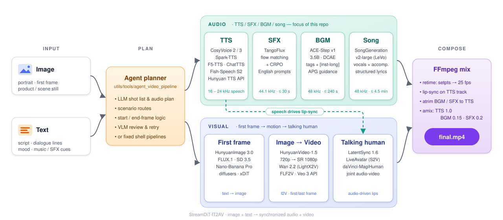

# 端到端流水线

> 四条可以直接跑的 IT2AV 链路，从"最可控"到"最一体化"排列。所有脚本开头都会 `source script/common/env.sh`，路径由 `IT2AV_WORKSPACE`（共享盘）/ `IT2AV_LOCAL_ROOT`（本地高速盘）决定，模型会先经 `fast_sync.py` 同步到本地盘再加载。
> 通用开关：`--cases 1,3`（只跑部分 case）、`--skip_sync`（不同步，直接读共享盘）、`--force_sync`（强制刷新本地缓存）。

| 链路 | 入口 | 思路 | 适合 |
|---|---|---|---|
| [Pipeline 2：分步编排](#1-pipeline-2分步编排推荐) | `script/digit/pipeline2/` | TTS / BGM / SFX → I2V → 慢放 + 对口型 → 混音 | 口播、数字人，质量可控 |
| [Pipeline 3：MagiHuman](#2-pipeline-3davinci-magihuman-一步生成) | `script/digit/pipeline3_magihuman/` | 首帧 + 文本 → 音视频一步生成 | 快速出片、音画天然同步 |
| [数字人 v1：LiveAvatar](#3-数字人-v1liveavatar--i2v-动作续接) | `script/digit/step*.sh` | 人像 → TTS → LiveAvatar 说话 → Wan2.2 动作续接 → 合成 | 长时说话 + 动作镜头 |
| [Agent 流水线](#4-agent-流水线) | `utils/tools/agent_video_pipeline/` | LLM 分镜 → 场景策略选路 → 各阶段生成 → VLM 审核 → 拼接 | 多镜头叙事（漫剧 / 美女 / 历史 / 口播） |

> 示例 case（5 句"晚上好……"台词 + 5 张人像）的图片属于内部数据，未随仓库发布。请把自己的图片放到 `${IT2AV_WORKSPACE}/data/pics/...`，并修改脚本顶部的 case 配置。

---

## 1. Pipeline 2：分步编排（推荐）



### Step 1 · 音频（三卡并行）

```bash
bash script/digit/pipeline2/step1_generate_audio.sh                 # 全部 case, TTS + BGM + SFX
bash script/digit/pipeline2/step1_generate_audio.sh --only tts      # 只跑 TTS
bash script/digit/pipeline2/step1_generate_audio.sh --only bgm,sfx --cases 1,3
```

| GPU | 模型 | 输出 |
|---|---|---|
| 0 | Spark-TTS（female / moderate / moderate） | `case_N/tts.wav` |
| 1 | ACE-Step（纯音乐 BGM） | `case_N/bgm.wav` |
| 2 | TangoFlux（环境音） | `case_N/sfx.wav` |

### Step 2 · 首帧生视频（8 卡）

```bash
bash script/digit/pipeline2/step2_generate_video.sh                 # 720p → SR 1080p, 8 卡
bash script/digit/pipeline2/step2_generate_video.sh --no_sr         # 只要 720p
bash script/digit/pipeline2/step2_generate_video.sh --num_gpus 4 --no_cfg_distill --sage_attn
```

HunyuanVideo-1.5 I2V，121 帧 / 24 fps（约 5 s）；`--resolution 720p --sr true`，关闭 offload，开启 CFG 蒸馏 + DeepCache；同时保存 SR 前的 720p 版本。启动前会检查 `Glyph-SDXL-v2` 是否在本地盘，缺失时自动从共享盘补同步。

### Step 3 · 慢放 + 对口型 + 混音

```bash
bash script/digit/pipeline2/step3_lipsync_merge.sh                  # 3a + 3b + 3c
bash script/digit/pipeline2/step3_lipsync_merge.sh --only lipsync --cases 1
bash script/digit/pipeline2/step3_lipsync_merge.sh --only merge --no_sfx --vol_bgm 0.2
```

```text
raw_video.mp4 (≈5 s, 24 fps)
   │ 3a  ffmpeg setpts=PTS*(TTS时长/视频时长), -r 25, -an
   ▼
slowmo_video.mp4 (= TTS 时长, 25 fps)
   │ 3b  LatentSync 1.6 (stage2_512, 25 steps, guidance 1.5, DeepCache)
   ▼
lipsync_video.mp4
   │ 3c  BGM / SFX atrim 到 TTS 时长 → amix (TTS 1.0 / BGM 0.15 / SFX 0.2)
   ▼
final.mp4
```

参数：`--lipsync_steps`、`--guidance`、`--vol_tts / --vol_bgm / --vol_sfx`、`--no_bgm`、`--no_sfx`、`--only slowmo|lipsync|merge`。

> `script/digit/step_digit_beauty_pipeline.sh` 是三步合一的旧版（`--steps tts,bgm,sfx,video,lipsync,merge`），逻辑相同。

---

## 2. Pipeline 3：daVinci-MagiHuman 一步生成

```bash
bash script/digit/pipeline3_magihuman/prepare_inputs.sh            # 复用 pipeline2 的图片, 自动写 Enhanced Prompt
bash script/digit/pipeline3_magihuman/run_magihuman.sh             # distill 模式 (8 步, 无 CFG, 256p, 最快)
bash script/digit/pipeline3_magihuman/run_magihuman.sh --mode sr540p     # base 32 步 + 540p 超分 (推荐)
bash script/digit/pipeline3_magihuman/run_magihuman.sh --mode sr1080p --num_gpus 8 --seconds 10
bash script/digit/pipeline3_magihuman/run_duration_stress.sh       # 不同时长的显存 / 耗时压力测试
```

- 输入：`case_N/image.png` + `case_N/prompt.txt`（MagiHuman 的 Enhanced Prompt 格式，中文逐字加空格）；
- 输出：`magihuman_video.mp4`（音视频）、`magihuman_video_video.mp4`、`magihuman_video_audio.wav`；
- `config_{distill,sr540p,sr1080p}.json` 是模板，运行时会改写成实际模型路径；
- 显存问题见 [踩坑 H6](environment_pitfalls.md#h6-davinci-magihuman-显存峰值与-magi_compiler)。

---

## 3. 数字人 v1：LiveAvatar + I2V 动作续接

```bash
bash script/digit/step1_generate_images.sh      # HunyuanImage 3.0 API 生成人像首帧
bash script/digit/step2_generate_audio.sh       # TTS + BGM + SFX (GPU 5/6/7); 有混元 API 时 TTS 走混元, 否则 CosyVoice
bash script/digit/step2a_hunyuan_tts.sh         # (可选) 单独用混元 TTS 2.5 重做台词
bash script/digit/step3_liveavatar_talking.sh   # LiveAvatar 5 卡 TPP (4 DiT + 1 VAE, FP8, 4 steps) 说台词
bash script/digit/step4_i2v_action.sh           # 取说话视频最后一帧 → Wan2.2-I2V-A14B (LightX2V, 8 卡) 动作续接
bash script/digit/step5_merge_final.sh <video.mp4> [bgm.wav] [sfx.wav]   # 拼接 + 混音
```

- `run_digit_pipeline.sh 5gpu|1gpu` 是更早的一键版本（Banana 生人像 → edge-tts → LiveAvatar）；
- LiveAvatar 的环境：`bash script/digit/setup_liveavatar_env.sh`、`requirements_liveavatar.txt`；快速自检：`run_liveavatar_quick_test.sh`（单卡）/ `run_liveavatar_5gpu_quick_test.sh`；
- 调试 CosyVoice：`bash script/digit/run_debug_tts.sh`（调用 `debug_cosyvoice_tts.py` / `debug_cosyvoice_weights.py`）。

---

## 4. Agent 流水线

```bash
cd utils/tools/agent_video_pipeline

# 只出计划 (分镜 / 选路 / 审核清单), 不执行
python main.py run --prompt "一个女主播在介绍新款手机，背景是简洁的白色直播间" --duration 10 --dry-run

# 本地 GPU 推理
python main.py run --prompt "..." --duration 10 --scenario narration_avatar --quality-tier quality

# CPU / API 调试链路 (LLM 分镜 → 生图 → VLM 审核 → Veo 或本地关键帧视频 → 拼接)
python main.py run --prompt "..." --duration 8 --execution-mode cpu

# 单步工具
python main.py image   --prompt-file shot.txt --output img.png --size 768x1280
python main.py lipsync --video raw.mp4 --audio tts.wav --output lipsync.mp4
python main.py edit concat --video a.mp4 --video b.mp4 --output merged.mp4
```

**场景策略**（`scenario_framework.py`）：

| 场景 | 生成链路 | 审核重点 |
|---|---|---|
| `comic_drama` 漫剧 | 剧本 → 漫画网格图 → 拆格作首尾帧 → FLF2V | 格间连续性、角色一致性 |
| `beauty_glamour` 美女 | look anchor → 审美筛选首帧 → 小幅高质量运动 | 审美、肢体 / 手部畸形 |
| `historical_reenactment` 历史 | 时代参考包 → 分镜 → 受控视频 | 服饰 / 器物考据 |
| `narration_avatar` 口播 | 台词切段 → speaker anchor → 对口型 | ASR 一致性、口型同步 |
| `generic` | 默认 | 通用质量 |

**视频路由**：`hyvideo_lipsync`（≤5 s 口播）、`hyvideo_longform`（>5 s，尾帧续接分段）、`wan22_i2v`、`wan22_flf2v`（首尾帧精确控制）、`wan22_lipsync`、`magihuman_av`（MV / 氛围片）。规划器产出 `scenario / storyboard / agent_roles / generation_chain / review_plan`，每个镜头单独选择路由和 fallback。

**需要的环境变量**：`VENUS_API_BASE`、`ENV_VENUS_OPENAPI_SECRET_ID`、`ENV_VENUS_OPENAPI_SECRET_KEY`、`VENUS_APP_GROUP_ID`（LLM / 生图）、`VENUS_VIDEO_APP_GROUP_ID`（Veo / Kling，必须 SDK 签名）。这是一个 OpenAI 兼容网关的封装，换成你自己的网关只需改 `api_clients.py`。详细设计见 `utils/tools/agent_video_pipeline/README.md`。

---

## 5. 单模型 benchmark

| 类别 | 脚本 |
|---|---|
| 音频 | `script/audio/run_audio_benchmark.sh`、`run_tts_benchmark.sh`、`run_{tangoflux,ace_step,songgen,cosyvoice,spark_tts,f5tts,chattts,fish_speech}.sh` |
| 视频 | `script/video/run_hyvideo15_{native,lightx2v}_benchmark.sh`、`run_wan22_{i2v,ti2v,a14b,flf2v,vace_flf2v,diffusers}_benchmark.sh`、`run_wan21_{flf2v,vace_flf2v}_benchmark.sh`、`run_lingbot_benchmark.sh`、`run_single_gpu_benchmark.sh` |
| 图像 | `script/image/run_t2i_benchmark.sh`（`run_t2i_diffusers.py` / `run_t2i_xdit.py`） |
| 工具 | `generate_camera_poses.py`（LingBot 相机轨迹）、`prepare_vace_flf2v.py`（VACE 首尾帧输入）、`fast_sync.py`（共享盘 → 本地盘多线程同步） |
